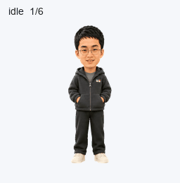

# DragonSon · 龙哥

以真人参考照片为灵感制作的动态桌面伙伴素材：短黑发、细圆框眼镜、修长脸型和深色连帽外套。包含九组状态动作与十六方向视线，采用透明背景的 Pets v2 图集。



## 成品

- [透明动作图集](assets/spritesheet.png)
- [完整动作视频](previews/all-states.mp4)
- [十六方向视线预览](previews/look-loop.gif)
- [待机—跳跃—待机预览](previews/idle-jump-idle.gif)
- [动作总览](assets/contact-sheet.png) · [方向检查图](assets/directions.png)

图集尺寸为 **1536 × 2288**，采用 **8 列 × 11 行**布局；每格 **192 × 208**。共 73 个有效单元，15 个未使用单元保持全透明。

| 行 | 状态 | 帧数 |
| --- | --- | ---: |
| 0 | idle · 待机 | 6 |
| 1 | running-right · 向右跑 | 8 |
| 2 | running-left · 向左跑 | 8 |
| 3 | waving · 挥手 | 4 |
| 4 | jumping · 跳跃 | 5 |
| 5 | failed · 受挫反应 | 8 |
| 6 | waiting · 等待输入 | 6 |
| 7 | running · 专注工作 | 6 |
| 8 | review · 复核 | 6 |
| 9–10 | look · 十六方向视线 | 16 |

`running` 表示原地思考和工作。视线方向按屏幕坐标顺时针排列，`000°` 为向上、`090°` 为向右、`180°` 为向下、`270°` 为向左。

## 使用

在已连接 Pets 的环境中，提供 `assets/spritesheet.png`，请 create-pet 技能验证并创建名为“龙哥”的宠物，再按需要启用。创建和选择由 Pets 服务完成；下载仓库本身不会更改账户中的当前宠物。

本地可检查文件完整性或重新导出预览：

```bash
conda run -n searchformoney pip install -r requirements.txt
conda run -n searchformoney python tools/verify_assets.py
conda run -n searchformoney python tools/render_previews.py --help
conda run -n searchformoney python tools/render_previews.py --atlas assets/spritesheet.png --output-dir scratch/previews
```

预览导出需要 `ffmpeg` 位于 `PATH`。预览工具仅裁取现有图集中的像素，不生成新的角色画面。

## 项目内容

```text
assets/       最终图集、头像和检查总览
previews/     GIF、MP4、状态动画与静帧
source/       已选基础形象与源动作条
validation/   最终验证与视觉审查记录
tools/        完整性检查和预览导出工具
manifest.json 成品元数据与文件校验值
```

最终图集已通过结构检查、质量检查和三份独立方向复核。完整性工具用于校验文件与清单是否一致；制作过程和已知轻微差异见 [制作说明](docs/production.md)。

当前未指定开源许可证。
